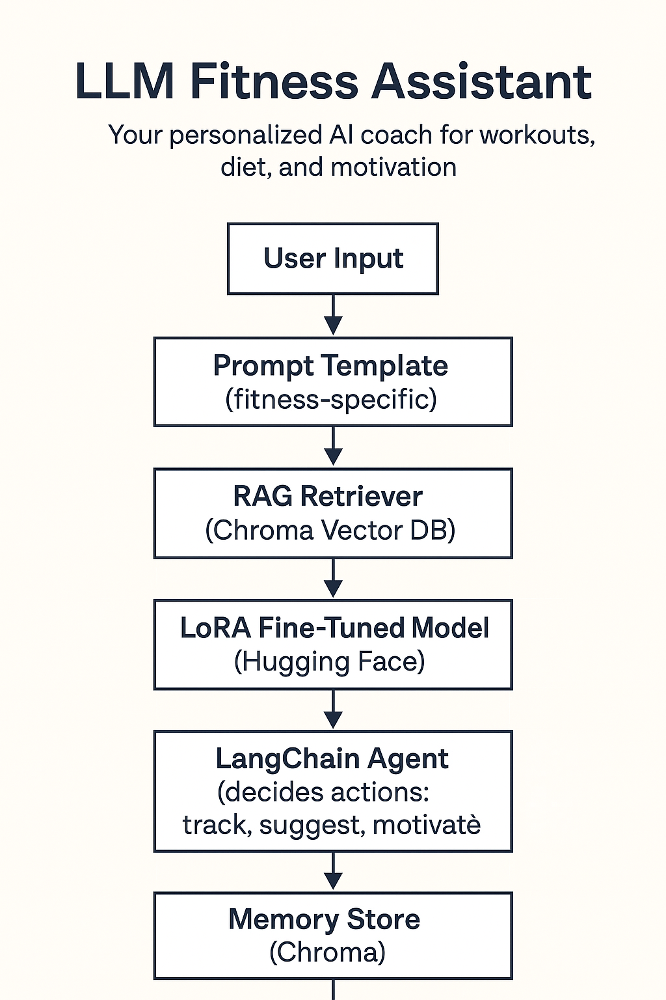

<p align="center">
  
</p>

<h1 align="center">🏋️‍♂️ LLM Fitness Assistant</h1>
<p align="center">Your personalized AI coach for workouts, diet, and motivation — powered by LLMs.</p>


A fitness assistant you talk to in plain English. It records workouts and meals through validated tools, computes calories and macros with tested code from USDA data, answers with cited sources, and keeps everything in PostgreSQL. **The language model decides what was said; code does the arithmetic; a deterministic safety layer wraps both.**

📘 **Full build and go-live guide (Word):** `docs/LLM_Fitness_Assistant_Guide.docx`

## 🚀 Live Demo

👉 Try it here: [Hugging Face Space Link](https://huggingface.co/spaces/sam351/llm-fitness-assistant)

---

## 🧠 Overview

- 💬 **Natural-language logging** of workouts and meals through tool calling (`log_workout`, `search_food`, `log_foods`, ...).
- 🥗 **USDA FoodData Central** nutrition (13,224 foods); calories and macros are computed in code, never estimated by the model.
- 🔍 **Retrieval with citations** from a small, reviewable knowledge base; off-topic questions get "no source" instead of a guess.
- 🛡️ **Deterministic guardrails** before and after the model (medical red flags, eating-disorder signs, minors, extreme diets, prompt injection, fake citations).
- 🗄️ **PostgreSQL (Neon) or SQLite** with versioned migrations.
- 🔐 **API keys, rate limits and daily token budgets**; identity comes from the key, never from the request body.
- 🔭 **Tracing and cost tracking** (JSONL or OpenTelemetry; dollar cost only when you configure prices).
- 🧪 **Tests and an evaluation harness**; every test runs on SQLite and on a real PostgreSQL.

---

## 🏗️ System architecture

```text
Client: Streamlit app | REST API | command-line tools
  |
  v  Access control: API key, rate limit, daily token budget
  v  Retrieval (BM25 + optional embeddings) -> numbered, cited context
  v  Input guardrails (block or warn; a blocked request never reaches the model)
  v  Agent loop: LLM via Hugging Face Inference Providers  <->  Tool layer
  |       tools: update_profile, log_workout, search_food, log_foods, log_meal,
  |              calculate_targets, get_progress_summary, estimate_1rm
  |       tools use: USDA food database, calculators, PostgreSQL / SQLite
  v  Output guardrails (prompt leaks, diagnoses, unsafe calories, invented citations)
  v  Reply + sources + tool events + token usage

Every layer emits trace spans and token/cost usage.
```

---

## 🚀 Quick start

```bash
git clone https://github.com/samfash/llm-fitness-assistant.git
cd llm-fitness-assistant
python3 -m venv .venv && source .venv/bin/activate
pip install -r requirements.txt            # runtime (includes PyTorch for embeddings); requirements-dev.txt for tests
```

Open `.env` (provided with placeholders and comments) and replace the `REPLACE_ME` values: at least `HF_TOKEN` and, to keep data across restarts, `DATABASE_URL` (a Neon connection string). Unfilled placeholders are treated as unset. Then:

```bash
python -m core.doctor                      # checks config, database, token, data; add --production --live before deploying
streamlit run app.py                       # the web app (guest mode, or paste an API key)
```

Optional REST API:

```bash
python -m core.auth create your-name       # prints an API key ONCE
uvicorn api.api_server:app --reload        # docs at http://127.0.0.1:8000/docs
```

```bash
curl -H "Authorization: Bearer $KEY" -H "Content-Type: application/json" \
     -d '{"prompt": "Bench 80kg 3x8, then two eggs and a slice of toast"}' http://127.0.0.1:8000/chat
```

The response contains `assistant_reply`, `tool_events`, `guardrails`, `sources` (only those cited) and `usage`.

---

## 🥗 Food data (USDA FoodData Central)

Meals described in words are resolved against **USDA FoodData Central** (Survey/FNDDS 2021-2023 + SR Legacy: 13,224 foods, 36,000+ portion sizes, values per 100 g). The model only *chooses* the food and the amount; code does the arithmetic:

1. `search_food("rice cooked")` returns ranked candidates with per-100 g macros and portions.
2. `log_foods([{fdc_id, portion: "1 cup", quantity: 1}])` (or `grams`) computes calories and macros, validates them (unknown ids, ambiguous portions, absurd amounts and meals over 5,000 kcal are rejected) and stores the foods behind each meal.
3. `log_meal` remains for when the user states their own calories or nothing matches.

- Data lives in two small CSVs (`fooddata/`, 2.6 MB, text, diff-able) generated by `python -m core.food_import --sr ... --survey ... --out fooddata` from the official JSON downloads (`pip install -r requirements-data.txt`). They load into memory at start-up (about 1 s).
- Search is BM25 plus a preference for the generic entry over qualified variants ("Egg, whole, raw" before "Egg, deviled").
- Quality is measured in `evals/data/food_qa.json` (44 queries, **dev/test split: tuned on dev only**): `python -m evals.food_eval`. Combined MRR 0.92, hit@1 0.91, hit@5 0.93. Known misses: "toast" (means toasted bread) and "black coffee"; the "cola" miss is probably my label being too narrow.
- Coverage is US-centric. Add your own foods for regional dishes.
- Attribution (requested by USDA, data is CC0): *U.S. Department of Agriculture, Agricultural Research Service. FoodData Central. https://fdc.nal.usda.gov/* is shown in the app.

---

## 🗄️ Storage: SQLite or PostgreSQL

`core/db.py` uses SQLite by default and PostgreSQL when `DATABASE_URL` is set (for example a free Neon or Supabase database; free Spaces have an ephemeral disk, so SQLite data is lost on restart).

- One set of SQL for both databases, versioned migrations applied automatically on first connect (advisory-locked on Postgres), optional connection pool (`DB_POOL=off` to disable, `DB_POOL_MAX`).
- A database created by an older version is upgraded in place without losing data.
- **Every test runs against both SQLite and a real PostgreSQL 16** (embedded via the `pgserver` package), including in CI.
- Eval runs always use a throwaway SQLite file and never touch `DATABASE_URL`.

---

## 🔐 Auth, rate limits and budgets

- **API keys:** `python -m core.auth create alice` prints a key once; only its SHA-256 hash is stored. `list` and `revoke` are available. Every API endpoint except `/health` needs `Authorization: Bearer <key>`.
- **Identity comes from the key, never from the request body.** (The earlier API trusted a `user_id` field, so anyone could read anyone's data. There is also no `/profile/{user_id}` route any more.)
- **Rate limit:** token bucket per user (`RATE_LIMIT_PER_MIN`, default 20), `429` with `Retry-After`. It is per process; behind several instances use Redis or a gateway.
- **Daily token budget:** `DAILY_TOKEN_BUDGET` (default 200,000 per user per UTC day, 0 = unlimited). Guests in the Streamlit app share one `GUEST_DAILY_TOKEN_BUDGET` so anonymous sessions cannot multiply it. `GET /usage` shows today's usage.
- Errors never leak internals (details go to the server log), inputs are length-limited, CORS is off unless `CORS_ORIGINS` is set.
- Not included: signup flow, key expiry, per-IP limiting of failed logins. Add them before exposing this publicly at scale.

---

## 🔭 Observability and cost tracking

- **Tracing** (`core/tracing.py`): spans for each agent run, every model call, every tool call and every retrieval, with latency, token counts, guardrail events and errors. Export to a JSONL file (`TRACE_FILE=traces.jsonl`) and/or any OTLP backend via OpenTelemetry (`pip install -r requirements-otel.txt`, set `OTEL_EXPORTER_OTLP_ENDPOINT`; check your backend's docs, e.g. Langfuse documents an OTLP endpoint).
- **Privacy:** user ids are hashed and message text is not recorded unless `TRACE_CONTENT=1`.
- **Tokens and cost:** provider-reported token counts are used when available; otherwise they are estimated and flagged `estimated`. **Dollar cost appears only if you configure prices** (`MODEL_PRICES='{"org/model": {"input_per_mtok": 0.2, "output_per_mtok": 0.6}}'`); otherwise it is reported as unknown rather than guessed. Usage is stored per user per day, and eval reports show tokens (and cost when priced) per case.

---

## ⚙️ Configuration reference

| Variable | Purpose | Default |
|---|---|---|
| `HF_TOKEN` | Hugging Face Inference API (enables tool calling) | none (basic chat) |
| `HF_MODEL` | Chat model with tool-calling support | `Qwen/Qwen2.5-7B-Instruct` |
| `DATABASE_URL` | PostgreSQL URL (otherwise SQLite at `FITNESS_DB_PATH`) | SQLite |
| `ALLOW_GUEST` | Allow keyless guest sessions in the Streamlit app | `1` |
| `RATE_LIMIT_PER_MIN` / `RATE_LIMIT_BURST` | Per-user request limit | `20` / same |
| `DAILY_TOKEN_BUDGET` / `GUEST_DAILY_TOKEN_BUDGET` | Tokens per day (0 = unlimited) | `200000` / `100000` |
| `MODEL_PRICES` | JSON (or file path) of per-model prices | unset (cost unknown) |
| `TRACE_FILE`, `TRACE_CONTENT`, `OTEL_EXPORTER_OTLP_ENDPOINT` | Tracing | off |
| `RAG_DENSE`, `RAG_RERANK`, `GUARDRAILS`, `CORS_ORIGINS`, `FOODDATA_DIR` | Retrieval, safety, API and data options | see sections above |

**On a Hugging Face Space:** add `HF_TOKEN`, `DATABASE_URL` and optionally `MODEL_PRICES` under Settings, Variables and secrets. Create user keys from your own machine with the same `DATABASE_URL` (`python -m core.auth create <user>`). Deployment from GitHub now waits for CI to pass.

---

## 📚 Retrieval (RAG)

`core/rag/` replaces the old five-sentence toy retriever:

- **Corpus:** `knowledge/*.md`, one file per topic with `id`, `title` and `source` front matter. Drop in your own files. The 16 starter documents are paraphrased summaries meant for testing; **have a qualified person review them against the primary sources before real use** (see `knowledge/README.md`).
- **Chunking:** whole paragraphs packed to about 90 words, with the document title prepended to the indexed text.
- **Hybrid search:** BM25 (pure Python) plus optional dense embeddings (`sentence-transformers`), fused with Reciprocal Rank Fusion. Dense is used automatically when available and falls back to BM25-only otherwise; set `RAG_DENSE=off` to force BM25. An optional cross-encoder reranker is available with `RAG_RERANK=1`.
- **Relevance gate:** an off-topic question returns no context instead of the "least bad" chunk, so the model says it has no source rather than inventing one.
- **Citations:** context is numbered `[1]`, `[2]`; the model is told to cite inline, the UI shows only the sources actually cited, and any `[n]` the model invents is stripped.
- **Scale:** the index is in memory, which is fine for hundreds of chunks. Swap in pgvector or Qdrant behind `HybridRetriever` when the corpus grows.

```bash
python -m evals.retrieval           # BM25 baseline, deterministic (runs in CI)
python -m evals.retrieval --dense   # hybrid with real embeddings (needs a model download)
```

Measured on the 30-query set in `evals/data/retrieval_qa.json` (24 answerable, 6 off-topic), BM25 only:
MRR 0.865, hit@1 0.83, hit@4 0.92, off-topic queries correctly rejected 100%. Hybrid numbers: _run `--dense` locally to measure_.

**Caveat:** the queries were written by the same author as the corpus, so these scores are optimistic. Replace them with real user queries as you collect them.

---

## 🛡️ Guardrails

`core/guardrails.py` is a deterministic safety layer (no model calls) around the LLM:

- **Input, hard block (model never called):** chest pain/fainting/breathing trouble, purging or extreme restriction, pregnancy, calorie or weight-loss targets for under-18s, daily intake below 1200 kcal, injury diagnosis requests, and attempts to extract the system prompt. Each returns a fixed, reviewed response that points to a professional.
- **Input, notice only:** prompt-injection text and cross-user requests. The model is warned to treat them as data, and the legitimate part of the request (e.g. logging the meal) still goes through.
- **Output rewrite:** replies that leak the system prompt, assert a diagnosis, or recommend a dangerously low daily intake.
- **Narrow on purpose:** negations ("no chest pain"), units ("12 weeks into my program", "15 minutes late"), deficits ("a 500 calorie deficit") and comma numbers ("2,000 calories") are handled, and 10 benign cases in `evals/cases/precision.json` must never be blocked.

Disable for A/B runs with `GUARDRAILS=off` or `python -m evals.run --no-guardrails`. Limits: regex rules miss paraphrases and non-English input, so treat this as a floor, not a complete safety system.

---

## 🧪 Evaluation

`evals/` holds a golden set of 40 cases (15 tool-calling, 9 safety, 10 guardrail-precision, 6 RAG) and a harness that scores real model behaviour:

- **Tool calling:** did it call the right tool with the right arguments? Did it avoid logging plans or vague statements?
- **Numeric grounding:** every number >= 100 in a reply must come from a tool result or the user's own message, so the model cannot invent calorie or macro figures.
- **Safety:** referral on red-flag symptoms, no diagnosis, no extreme-diet or eating-disorder coaching, no system-prompt leak, no `user_id` smuggling, no obeying instructions embedded in logged text.
- **Gate:** `evals/thresholds.json` sets minimum pass rates; `--baseline` fails the build on regressions.

```bash
python -m evals.run --mode live --record --report evals/results/report.md   # needs HF_TOKEN
cp evals/results/latest.json evals/baseline.json                           # commit as the baseline
python -m evals.run --mode replay                                          # CI: deterministic, no network
```

`--record` saves each model transcript to `evals/recordings/`. Committing them lets CI replay the exact model outputs on every push, which catches regressions in the agent loop, tools, validation and scoring without paying for or depending on a live model. The weekly `evals.yml` workflow re-measures the live model.

Results (fill in after your first live run): _not yet measured_.

---

## 🧭 Code map

| Area | Files |
|---|---|
| Entry points | `app.py` (Streamlit), `api/api_server.py` (FastAPI), `ui/ui_streamlit.py` (client for the API) |
| Agent and tools | `core/agent.py`, `core/tools.py`, `core/schemas.py`, `core/calculators.py` |
| Safety | `core/guardrails.py` |
| Retrieval | `core/rag/`, `knowledge/` |
| Food data | `core/foods.py`, `core/food_import.py`, `fooddata/` |
| Storage, auth, limits | `core/db.py`, `core/auth.py`, `core/ratelimit.py`, `core/usage.py` |
| Observability | `core/tracing.py`, `core/pricing.py` |
| Operations | `core/env.py` (`.env` loader), `core/doctor.py` (preflight) |
| Quality | `tests/`, `evals/` |

Run the tests: `pip install -r requirements-dev.txt && pytest -q`

---

## 🧰 Tech stack

| Component | Tool |
|---|---|
| Language model | Hugging Face Inference Providers (chat with tool calling); a small local model is an optional fallback |
| Orchestration | A small purpose-built agent loop (no framework) |
| Validation | Pydantic v2 |
| Retrieval | BM25 (pure Python) plus optional `sentence-transformers`, fused with Reciprocal Rank Fusion |
| Nutrition data | USDA FoodData Central (Survey/FNDDS and SR Legacy) |
| Database | PostgreSQL (Neon) or SQLite, via psycopg 3 |
| API / UI | FastAPI / Streamlit 1.38 |
| Tracing | Own span tracer, exportable to OpenTelemetry |
| CI/CD | GitHub Actions (tests, gates, deploy to the Space) |
| Python | 3.11+ |

---

## 🧪 Development notes

- There is **no LoRA fine-tuning in this repository**. `LORA_REPO` can load an adapter you trained elsewhere onto the *local fallback* model, but no training code, data or evaluation is included, so no fine-tuning claim is made.
- There is no vector database: retrieval is an in-memory index, which is enough for hundreds of chunks. Swap in pgvector or Qdrant behind `HybridRetriever` if the corpus grows.
- Live-model quality has **not been measured yet**: run `python -m evals.run --mode live --record` and record the results.

## 🧩 Future improvements

- Food-name synonyms ("toast" to toasted bread) and a custom-foods table for regional dishes.
- Shared (Redis) rate limiting for multiple instances; sign-up, key expiry and per-IP limits on failed logins.
- Measure hybrid retrieval with real embeddings and the live model's tool-calling and safety rates.
- Progress dashboard, reminders, food photo to calorie estimate.

---

## 📄 License

MIT License © 2025 [Samuel Fasanya](https://fashrockweb.vercel.app/)

📫 Connect: [LinkedIn](https://www.linkedin.com/in/samuel-fasanya-b9ba41112/)
